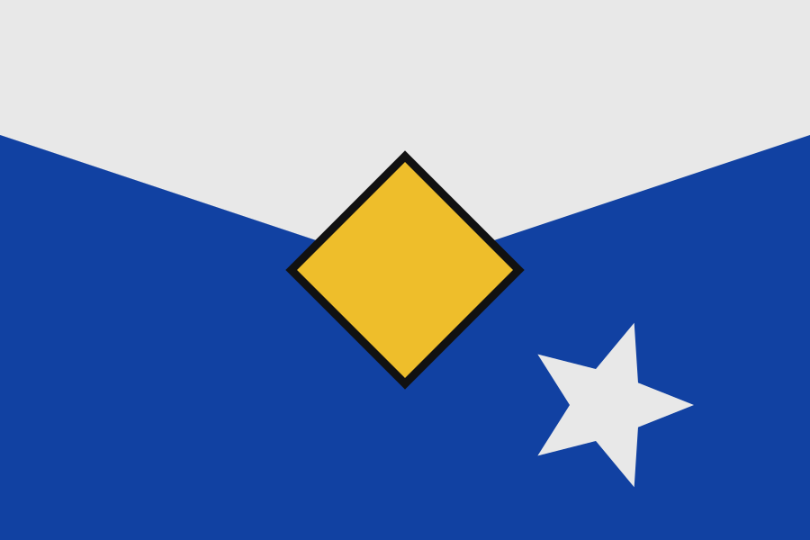
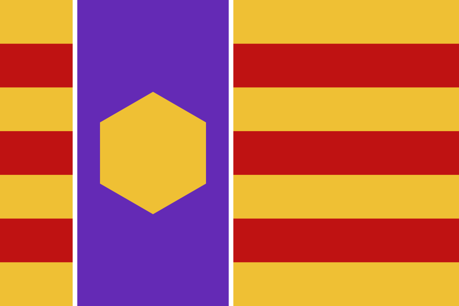
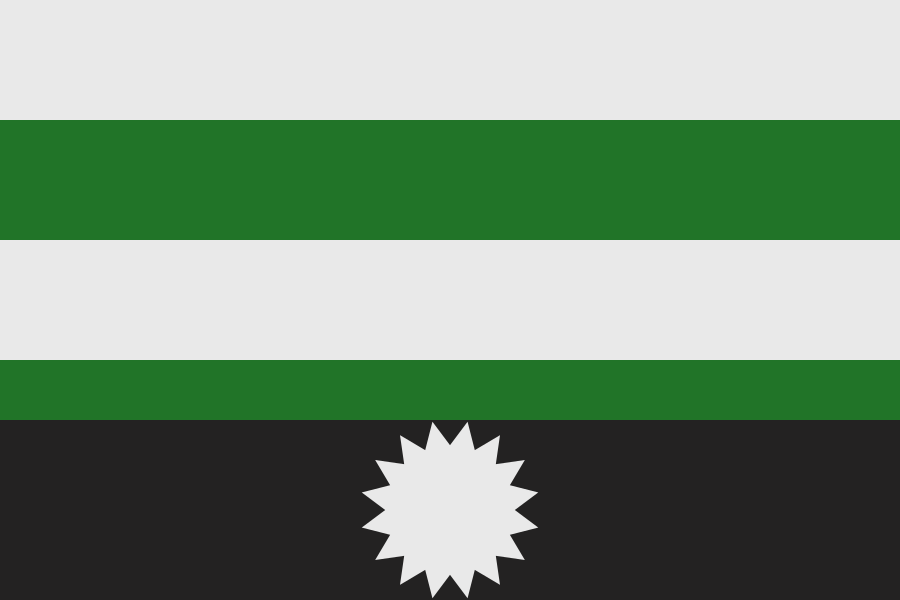

# Flaggen

Процедурный генератор флагов в геральдическом стиле на C++17 + Cairo.

Каждый флаг собирается из четырёх слоёв (поле → деление → полоса → эмблема),
соблюдает правило тинктуры и контраст, детерминирован по сиду и рендерится как
векторная графика (PNG / SVG / PDF).

| | | |
|---|---|---|
|  |  |  |

---

## Возможности

- **16 делений поля** — per_fess, per_pale, per_bend, per_saltire, per_quarterly,
  per_chevron, barry/paly/bendy, gyronny.
- **20 геральдических полос** — fess, pale, bend, cross, nordic, saltire, chevron,
  pile, pall, bordure, orle, chief, base, canton, lozenge и др.
- **15 эмблем** — звёзды, серп, солнце, кольцо, крест-пате, флёр-де-лис,
  трилистник и др.
- **Палитра с гарантиями контраста (WCAG)** и фолбэком синий/золото/белый.
- **Фимбриация** — геральдическая окантовка эмблемы и полосы.
- **Правила несовместимости**, симметрия шеврона, безопасная раскладка у краёв.
- **Вывод PNG / SVG / PDF**, размер любой, формат по умолчанию 1200×800 (3:2).
- **GUI-конструктор** (GTK3): случайный флаг, ручные слои/цвета, сохранение.
- **Всё настраивается** через `config/flags.json`.

## Требования

- CMake ≥ 3.16
- C++17 компилятор
- [cairo](https://www.cairographics.org/)
- GTK3 (только для `flaggen_gui`)
- nlohmann_json (опционально; иначе ищется в `/usr/include`)

Debian/Ubuntu:

```sh
sudo apt install cmake g++ libcairo2-dev libgtk-3-dev nlohmann-json3-dev
```

## Сборка

```sh
cmake -S . -B build
cmake --build build -j4
```

Бинарники: `build/flaggen` (CLI) и `build/flaggen_gui` (конструктор).

## Использование (CLI)

```sh
./build/flaggen --seed 42 --output flag.png          # PNG
./build/flaggen --seed 7  --width 1600 --height 1000 --output flag.svg
./build/flaggen --seed 1  --output flag.pdf
./build/flaggen --output auto.png                    # сид = время запуска
```

Формат: `flaggen [--seed N] [--width W] [--height H] --output <файл.png|svg|pdf>`.

В `stdout` печатается строка-метаданные флага:

```
seed=42 division=per_quarterly ordinary=saltire charge=fleur_de_lis (center)
row=1 palette=(#E8E8E8 #1242A2 #EEBD2C) charge=#1142A5 scale=0.75 contrast=7.43
ofimb anchors=(600,400) -> flag.png
```

- `contrast` — худший контраст эмблемы с фоном (WCAG);
- `fimbriation` — окантовка эмблемы; `ofimb` — окантовка полосы;
- `anchors` — координаты эмблем (несколько при рядах/компоновках).

### Пакетная генерация

```sh
for s in $(seq 1 100); do
  ./build/flaggen --seed $s --output batch/$s.png
done
```

## GUI

```sh
./build/flaggen_gui
```

Конструктор: **Случайный флаг**, выбор слоёв/цветов и **Применить**,
**Стереть рисунок**, **Сохранить…**.

## Конфигурация

`config/flags.json` — JSON со списками `divisions`, `ordinaries`, `charges`.
Каждый элемент: `render`-тип, геометрия (`thickness`, `size`, `outerRadius`,
`innerRadius`, `offsetX`, `points`), правила выравнивания (`rigidX`, `rigidY`,
`requiredAlignmentX/Y`, выражения вроде `"width/2"`) и `incompatible`-списки.

Добавление новой эмблемы: запись в `config/flags.json` + ветка в
`drawCharge()` в `src/layers.cpp` (см. `CONTRIBUTING.md`).

## Структура проекта

```
config/flags.json      — все деления, полосы, эмблемы и правила
src/color.*            — палитра и контраст (WCAG)
src/config.*           — загрузка конфигурации
src/layers.*           — отрисовка слоёв, эмблем, фимбриация
src/generator.*        — генерация кандидатов, раскладка, оценка, рендер
src/main.cpp           — CLI
src/gui.cpp            — GTK-конструктор
GDD.md                 — дизайн-документ проекта
```

## Документация

- [GDD.md](GDD.md) — дизайн-документ (алгоритмы, правила, дорожная карта)
- [CONTRIBUTING.md](CONTRIBUTING.md) — как вносить изменения
- [CHANGELOG.md](CHANGELOG.md) — история версий
- [SECURITY.md](SECURITY.md) — безопасность

## Лицензия

MIT — см. [LICENSE](LICENSE).

---

# Flaggen (English)

Procedural heraldic flag generator in C++17 + Cairo.

Each flag is composed of four layers (field → division → ordinary → charge),
respects the rule of tincture and contrast, is deterministic per seed, and
renders as vector graphics (PNG / SVG / PDF).

## Features

- **16 field divisions** — per_fess, per_pale, per_bend, per_saltire,
  per_quarterly, per_chevron, barry/paly/bendy, gyronny.
- **20 heraldic ordinaries** — fess, pale, bend, cross, nordic, saltire, chevron,
  pile, pall, bordure, orle, chief, base, canton, lozenge, etc.
- **15 charges** — stars, crescent, sun, annulet, cross-patee, fleur-de-lis,
  trefoil, etc.
- **Palette with guaranteed contrast (WCAG)** and a blue/gold/white fallback.
- **Fimbriation** — heraldic outline for both charges and ordinaries.
- **Incompatibility rules**, chevron symmetry, edge-safe layout.
- **PNG / SVG / PDF output**, any size; default 1200×800 (3:2).
- **GTK3 GUI constructor**: random flag, manual layers/colors, save.
- **Everything configurable** via `config/flags.json`.

## Requirements

- CMake ≥ 3.16, C++17 compiler
- cairo
- GTK3 (for `flaggen_gui` only)
- nlohmann_json (optional; otherwise searched in `/usr/include`)

Debian/Ubuntu:

```sh
sudo apt install cmake g++ libcairo2-dev libgtk-3-dev nlohmann-json3-dev
```

## Build

```sh
cmake -S . -B build
cmake --build build -j4
```

Binaries: `build/flaggen` (CLI) and `build/flaggen_gui` (constructor).

## Usage (CLI)

```sh
./build/flaggen --seed 42 --output flag.png          # PNG
./build/flaggen --seed 7  --width 1600 --height 1000 --output flag.svg
./build/flaggen --seed 1  --output flag.pdf
./build/flaggen --output auto.png                    # seed = wall clock
```

Usage: `flaggen [--seed N] [--width W] [--height H] --output <file.png|svg|pdf>`.

A metadata line is printed to stdout:

```
seed=42 division=per_quarterly ordinary=saltire charge=fleur_de_lis (center)
row=1 palette=(#E8E8E8 #1242A2 #EEBD2C) charge=#1142A5 scale=0.75 contrast=7.43
ofimb anchors=(600,400) -> flag.png
```

- `contrast` — worst-case charge contrast vs background (WCAG);
- `fimbriation` — charge outline; `ofimb` — ordinary outline;
- `anchors` — charge coordinates (several for rows/layouts).

### Batch generation

```sh
for s in $(seq 1 100); do
  ./build/flaggen --seed $s --output batch/$s.png
done
```

## GUI

```sh
./build/flaggen_gui
```

Constructor: **Random flag**, manual layers/colors + **Apply**, **Erase**,
**Save…**.

## Configuration

`config/flags.json` — JSON lists `divisions`, `ordinaries`, `charges`. Each entry
has a `render` type, geometry (`thickness`, `size`, `outerRadius`, `innerRadius`,
`offsetX`, `points`), alignment rules (`rigidX`, `rigidY`,
`requiredAlignmentX/Y`, expressions like `"width/2"`) and `incompatible` lists.

Adding a new charge: an entry in `config/flags.json` + a branch in `drawCharge()`
in `src/layers.cpp` (see `CONTRIBUTING.md`).

## Project structure

```
config/flags.json      — all divisions, ordinaries, charges and rules
src/color.*            — palette and contrast (WCAG)
src/config.*           — configuration loading
src/layers.*           — layer / charge rendering, fimbriation
src/generator.*        — candidate generation, layout, scoring, render
src/main.cpp           — CLI
src/gui.cpp            — GTK constructor
GDD.md                 — project design document
```

## Docs

- [GDD.md](GDD.md) — design document (algorithms, rules, roadmap)
- [CONTRIBUTING.md](CONTRIBUTING.md) — how to contribute
- [CHANGELOG.md](CHANGELOG.md) — version history
- [SECURITY.md](SECURITY.md) — security policy

## License

MIT — see [LICENSE](LICENSE).
