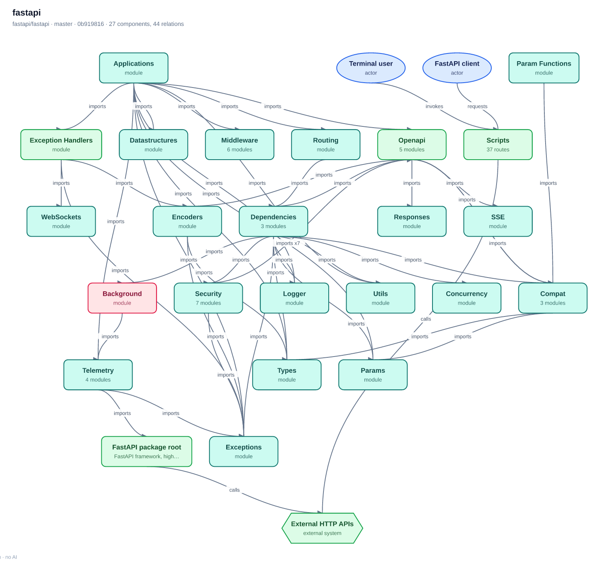

# staticdiagram

**Architecture diagrams for Python repositories from static analysis only.**
No LLM, no API keys, no prompt injection surface, no per-request cost.
The deterministic sibling of [GitDiagram](https://github.com/ahmedkhaleel2004/gitdiagram):
same graph contract, same Mermaid output, zero model calls.

```
$ staticdiagram fastapi/fastapi
fastapi/fastapi
  parsed 76 python modules, resolved 154 internal imports
  graph: 27 nodes, 44 edges, 0 groups (depth 2)
  wrote out/fastapi__fastapi/diagram.mmd
  wrote out/fastapi__fastapi/diagram.svg
  wrote out/fastapi__fastapi/README.md
  wrote out/fastapi__fastapi/graph.json
  wrote out/fastapi__fastapi/analysis.json
  wrote out/fastapi__fastapi/artifact.json
  wrote out/fastapi__fastapi/index.html
```



## What you get

| Artefact | Contents |
| --- | --- |
| `index.html` | Self-contained report: the map, components, connections with evidence, coverage. Opens offline, no CDN, no scripts. |
| `diagram.svg` | The map as a vector image with clickable nodes that open the exact file on GitHub. |
| `diagram.mmd` | Mermaid source compiled by a line-by-line port of GitDiagram's `compileDiagramGraph`. |
| `README.md` | Markdown twin: overview, component and connection tables, Mermaid block. |
| `graph.json` | The graph in GitDiagram's `DiagramGraph` schema (≤10 groups, ≤34 nodes, ≤48 edges). |
| `analysis.json` | Everything the analyser saw: per-component scores, PageRank, signals, infra, coverage. |
| `artifact.json` | A drop-in GitDiagram R2 artifact (`DiagramArtifact`, `version: 1`) — see below. |

## Install & run

```bash
git clone <this repo> && cd gitdiagram-static
pip install -e .            # or: python -m pip install --user .
staticdiagram owner/repo    # shallow clone + analyse
staticdiagram ./my-project  # or a local directory
staticdiagram https://github.com/owner/repo@branch --max-nodes 20 --png
```

Requirements: Python ≥ 3.10 and (for remote repositories) `git`. **Zero runtime
dependencies** — the analyser runs in a bare container, a CI job or an air-gapped
box:

```bash
docker build -t staticdiagram .
docker run --rm -v "$PWD:/work" -w /work staticdiagram ./my-project --out /work/out
```

Private repositories: `GITHUB_TOKEN=... staticdiagram owner/repo`.

## How a diagram is built (no model involved)

1. **Ingest** — shallow `git clone` (codeload tarball as fallback) or a local
   walk. Path filters (tests, fixtures, vendored, `.env`, secrets) are ported
   from GitDiagram's `repository-context.ts`, so both tools agree on what is
   product source.
2. **Facts** — every Python file is parsed with `ast`: imports (absolute,
   relative, `importlib`), route decorators, Celery tasks, click/typer commands,
   ORM bases, `__main__` guards, `os.environ` reads, and the driver each file
   talks to (Postgres, Redis, Kafka, Stripe, …). Unparsable files fall back to
   regex import scanning and are reported.
3. **Resolve** — dotted module names become repository paths through an index
   built from every source root the packaging metadata declares (`src/` layout,
   poetry `packages`, `package_dir`, monorepo packages).
4. **Aggregate** — file edges are folded into components at an adaptive
   directory depth (per-module for flat packages such as `requests`), weighted,
   and ranked with PageRank plus size/entry-point bonuses.
5. **Draw** — components become nodes (shapes for stores, queues, integrations),
   the strongest relations become edges, external systems and actors are added
   only when an import or a compose file proves them. Every edge keeps the file
   and line that showed the relation — its `evidencePath`.
6. **Explain** — the prose GitDiagram asks a model for is assembled from verified
   facts: README text, manifests, entry points, ranked dependencies, drivers,
   and an explicit *coverage and limits* section.

Determinism is a feature: the same commit always yields the same diagram, and
`tests/test_pipeline.py` asserts it.

## Parity with GitDiagram

`graph.json`, the Mermaid compiler and the validation rules mirror
`gitdiagram/src/features/diagram/graph.ts` and `src/server/generate/graph.ts`
(limits, id grammar, escaping table, tone classes, click links);
`tests/test_mermaid_parity.py` pins the compiler byte-for-byte. Because of that,
`artifact.json` is a valid `DiagramArtifact`: upload it to the bucket GitDiagram
reads and the site serves the diagram without ever calling a provider.

```bash
wrangler r2 object put "$R2_PUBLIC_BUCKET/public/v1/fastapi/fastapi.json" \
  --file out/fastapi__fastapi/artifact.json --content-type application/json
```

## What static analysis cannot see

Imports are the only traced wiring. Connections made through configuration,
HTTP calls between services, message brokers, plugin registries or
`globals()`-style dynamic imports are not detected; neither is runtime
behaviour. The report says exactly what was parsed, what was skipped and which
import roots were treated as external, so a reader can judge the map. Semantic
naming ("retrieval pipeline" instead of `src/lib/rag`) is the one thing a model
genuinely adds — here labels come from paths, docstrings and known entry points.

## Repository layout

```
src/staticdiagram/
  ingest.py        repository loading, path filters, packaging metadata
  pyanalysis.py    per-file facts via ast (routes, tasks, drivers, env vars)
  resolver.py      dotted module name -> repository path
  depgraph.py      components, PageRank, externals, shapes, graph assembly
  explain.py       deterministic prose and report sections
  mermaid.py       GitDiagram-parity Mermaid compiler
  svgrender.py     offline layered-layout SVG renderer (no dependencies)
  artifact.py      GitDiagram DiagramArtifact emitter
  report.py        markdown / html / json writers
  pipeline.py      orchestration; cli.py entry point
tests/             unittest suite, no third-party packages
tests/fixtures/    a small FastAPI-shaped project the tests analyse
demo/              rendered examples
```

## Быстрый старт (по-русски)

```bash
pip install -e .
staticdiagram owner/repo --out out      # диаграмма репозитория с GitHub
staticdiagram . --out out               # или локальная папка
xdg-open out/<slug>/index.html          # отчёт открывается офлайн
```

Ключевые флаги: `--max-nodes N` (бюджет узлов, ≤34), `--max-edges N` (≤48),
`--depth N` (глубина директорий для компонентов), `--include-tests`,
`--no-external`, `--no-actors`, `--stdout` (напечатать Mermaid и выйти),
`--png` (если в PATH есть `rsvg-convert` или `resvg`).

## License

MIT — see [LICENSE](LICENSE). Inspired by and wire-compatible with
[GitDiagram](https://github.com/ahmedkhaleel2004/gitdiagram) (MIT).
