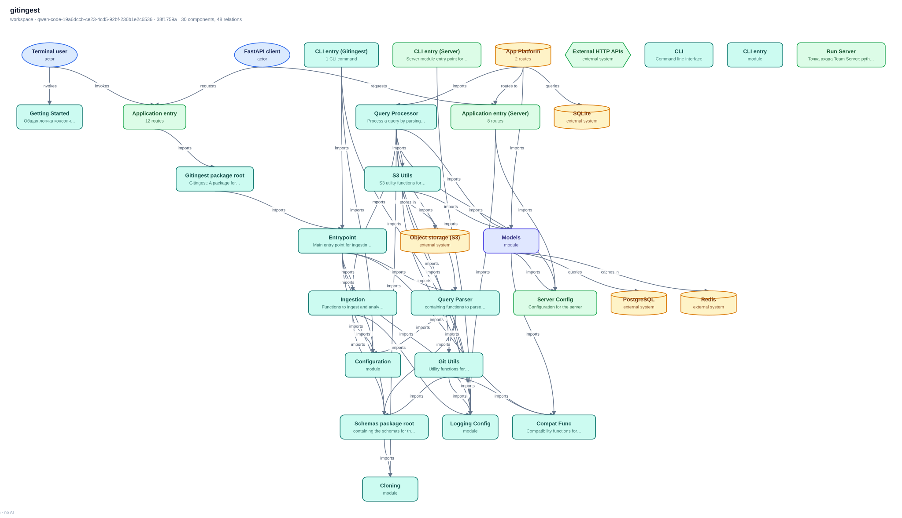

# gitingest — architecture map

local:/workspace · branch `qwen-code-19a6dccb-ce23-4cd5-92bf-236b1e2c6536` · commit `38f1759a2b` · generated by static analysis — no AI

> CLI tool to analyze and create text dumps of codebases for LLMs

## Overview

workspace is a Python codebase of 70 parsed modules (12,254 lines) packaging as `gitingest`. Its 23 main components are Application entry, Logging Config, Getting Started, Run Server, CLI entry (Gitingest), CLI entry (Server). HTTP requests are handled in `app_platform/main.py` (12 route handlers). Execution starts at `app_platform/main.py`, exposed as the `gitingest` command. The most depended-on module is `src/gitingest/utils/logging_config.py`, imported by 15 other components (15 import statements). Imports and infrastructure show external systems: External HTTP APIs, PostgreSQL, Redis, Object storage (S3). Built from 101 resolved internal imports; no model was called.

## Components

| Component | Path | Files | Lines | Used by | Uses | Signals |
| --- | --- | ---: | ---: | ---: | ---: | --- |
| Application entry | `app_platform/main.py` | 1 | 345 | 0 | 1 | entrypoint:script, http_server, web:fastapi |
| Logging Config | `src/gitingest/utils/logging_config.py` | 1 | 201 | 15 | 0 | — |
| Getting Started | `getting_started` | 3 | 494 | 0 | 0 | cli:argparse, entrypoint:script |
| Run Server | `run_server.py` | 1 | 15 | 0 | 0 | entrypoint:script |
| CLI entry (Gitingest) | `src/gitingest/__main__.py` | 1 | 205 | 0 | 3 | cli, cli:click, entrypoint:script |
| CLI entry (Server) | `src/server/__main__.py` | 1 | 33 | 0 | 1 | entrypoint:script |
| Schemas package root | `src/gitingest/schemas` | 1 | 8 | 7 | 3 | — |
| Server Config | `src/server/server_config.py` | 1 | 57 | 6 | 0 | http_server, web:fastapi |
| CLI | `gitdiagram-static/src/staticdiagram/cli.py` | 1 | 151 | 0 | 0 | cli:argparse, entrypoint:script |
| CLI entry | `gitdiagram-static/src/staticdiagram/__main__.py` | 1 | 5 | 0 | 0 | entrypoint:script |
| Configuration | `src/gitingest/config.py` | 1 | 15 | 7 | 0 | — |
| App Platform | `app_platform` | 5 | 419 | 0 | 3 | driver:sqlite, http_server, state:sql, web:fastapi |
| Models | `src/server/models.py` | 1 | 199 | 5 | 3 | schema:pydantic |
| Git Utils | `src/gitingest/utils/git_utils.py` | 1 | 532 | 5 | 4 | vcs:gitpython |
| Application entry (Server) | `src/server/main.py` | 1 | 214 | 1 | 5 | http_server, observability:errors, web:fastapi, web:starlette |
| Entrypoint | `src/gitingest/entrypoint.py` | 1 | 353 | 2 | 11 | — |
| Compat Func | `src/gitingest/utils/compat_func.py` | 1 | 45 | 5 | 0 | — |
| Gitingest package root | `src/gitingest` | 1 | 6 | 1 | 1 | — |
| Query Processor | `src/server/query_processor.py` | 1 | 430 | 2 | 11 | — |
| S3 Utils | `src/server/s3_utils.py` | 1 | 562 | 2 | 2 | cloud:aws, object_storage, observability:metrics |
| Ingestion | `src/gitingest/ingestion.py` | 1 | 326 | 2 | 5 | — |
| Cloning | `src/gitingest/schemas/cloning.py` | 1 | 43 | 3 | 0 | schema:pydantic |
| Query Parser | `src/gitingest/query_parser.py` | 1 | 191 | 2 | 5 | — |

## Connections

| From | Relation | To | Evidence |
| --- | --- | --- | --- |
| Application entry | imports | Gitingest package root | `app_platform/main.py` |
| CLI entry (Gitingest) | imports | Configuration | `src/gitingest/__main__.py` |
| CLI entry (Server) | imports | Logging Config | `src/server/__main__.py` |
| CLI entry (Gitingest) | imports | Logging Config | `src/gitingest/__main__.py` |
| Ingestion | imports | Schemas package root | `src/gitingest/ingestion.py` |
| Application entry (Server) | imports | Server Config | `src/server/main.py` |
| App Platform | routes to | Application entry (Server) | `app_platform/site_router.py` |
| App Platform | imports | Models | `app_platform/site_router.py` |
| Query Parser | imports | Git Utils | `src/gitingest/query_parser.py` |
| Gitingest package root | imports | Entrypoint | `src/gitingest/__init__.py` |
| Entrypoint | imports | Compat Func | `src/gitingest/entrypoint.py` |
| App Platform | imports | Query Processor | `app_platform/site_router.py` |
| Query Processor | imports | S3 Utils | `src/server/query_processor.py` |
| Schemas package root | imports | Cloning | `src/gitingest/schemas/__init__.py` |
| Entrypoint | imports | Query Parser | `src/gitingest/entrypoint.py` |
| CLI entry (Gitingest) | imports | Entrypoint | `src/gitingest/__main__.py` |
| Entrypoint | imports | Configuration | `src/gitingest/entrypoint.py` |
| Entrypoint | imports | Ingestion | `src/gitingest/entrypoint.py` |
| Entrypoint | imports | Schemas package root | `src/gitingest/entrypoint.py` |
| Entrypoint | imports | Logging Config | `src/gitingest/entrypoint.py` |
| Ingestion | imports | Configuration | `src/gitingest/ingestion.py` |
| Ingestion | imports | Logging Config | `src/gitingest/ingestion.py` |
| Query Parser | imports | Configuration | `src/gitingest/query_parser.py` |
| Query Parser | imports | Schemas package root | `src/gitingest/query_parser.py` |
| Query Parser | imports | Logging Config | `src/gitingest/query_parser.py` |
| Git Utils | imports | Schemas package root | `src/gitingest/utils/git_utils.py` |
| Git Utils | imports | Compat Func | `src/gitingest/utils/git_utils.py` |
| Git Utils | imports | Logging Config | `src/gitingest/utils/git_utils.py` |
| Application entry (Server) | imports | Logging Config | `src/server/main.py` |
| Models | imports | Compat Func | `src/server/models.py` |
| Models | imports | Server Config | `src/server/models.py` |
| Query Processor | imports | Ingestion | `src/server/query_processor.py` |
| Query Processor | imports | Query Parser | `src/server/query_processor.py` |
| Query Processor | imports | Cloning | `src/server/query_processor.py` |
| Query Processor | imports | Git Utils | `src/server/query_processor.py` |
| Query Processor | imports | Logging Config | `src/server/query_processor.py` |
| Query Processor | imports | Models | `src/server/query_processor.py` |
| Query Processor | imports | Server Config | `src/server/query_processor.py` |
| S3 Utils | imports | Logging Config | `src/server/s3_utils.py` |
| S3 Utils | imports | Models | `src/server/s3_utils.py` |
| Models | queries | PostgreSQL | `gitdiagram-static/tests/fixtures/shop_api/docker-compose.yml` |
| Models | caches in | Redis | `gitdiagram-static/tests/fixtures/shop_api/docker-compose.yml` |
| S3 Utils | stores in | Object storage (S3) | `src/server/s3_utils.py` |
| App Platform | queries | SQLite | `app_platform/db.py` |
| FastAPI client | requests | Application entry | `app_platform/main.py` |
| FastAPI client | requests | Application entry (Server) | `src/server/main.py` |
| Terminal user | invokes | Application entry | `app_platform/main.py` |
| Terminal user | invokes | Getting Started | `getting_started/gettingstarted_linux.py` |

## Entry points

- `app_platform/main.py` — part of **Application entry** (`app_platform/main.py`)
- `run_server.py` — part of **Run Server** (`run_server.py`)
- `src/gitingest/__main__.py` — part of **CLI entry (Gitingest)** (`src/gitingest/__main__.py`)
- `src/server/__main__.py` — part of **CLI entry (Server)** (`src/server/__main__.py`)
- `gitdiagram-static/src/staticdiagram/cli.py` — part of **CLI** (`gitdiagram-static/src/staticdiagram/cli.py`)
- `gitdiagram-static/src/staticdiagram/__main__.py` — part of **CLI entry** (`gitdiagram-static/src/staticdiagram/__main__.py`)
- `getting_started/gettingstarted_linux.py` — part of **Getting Started** (`getting_started`)
- `getting_started/gettingstarted_windows.py` — part of **Getting Started** (`getting_started`)
- CLI commands in `src/gitingest/__main__.py` — 1 command
- console script `gitingest` → `gitingest.__main__:main`
- HTTP routes in `app_platform/main.py` — 12 handlers
- HTTP routes in `app_platform` — 2 handlers
- HTTP routes in `src/server/main.py` — 8 handlers
- HTTP routes in `src/server/routers/ingest.py` — 3 handlers
- HTTP routes in `src/server/routers/dynamic.py` — 1 handler
- HTTP routes in `src/server/routers/index.py` — 1 handler

## State and external systems

- **External HTTP APIs** — used by `src/gitingest/output_formatter.py` (seen in `src/gitingest/output_formatter.py`)
- **PostgreSQL** — used by `src/server/models.py` (seen in `gitdiagram-static/tests/fixtures/shop_api/docker-compose.yml`)
- **Redis** — used by `src/server/models.py` (seen in `gitdiagram-static/tests/fixtures/shop_api/docker-compose.yml`)
- **Object storage (S3)** — used by `src/server/s3_utils.py` (seen in `src/server/s3_utils.py`)
- **SQLite** — used by `app_platform` (seen in `app_platform/db.py`)
- **MinIO (S3)** — service `minio` in `compose.yml`
- **MinIO (S3)** — service `minio-setup` in `compose.yml`
- **PostgreSQL** — service `db` in `gitdiagram-static/tests/fixtures/shop_api/docker-compose.yml`
- **Redis** — service `cache` in `gitdiagram-static/tests/fixtures/shop_api/docker-compose.yml`

## Runtime dependencies

`boto3`, `click`, `eval-type-backport`, `fastapi`, `gitpython`, `httpx`, `loguru`, `pathspec`, `pre-commit`, `prometheus-client`, `pydantic`, `pytest`, `pytest-asyncio`, `pytest-cov`, `pytest-mock`, `python-dotenv`, `sentry-sdk`, `slowapi` (of 23 declared)

## Deployment and operations

- `Dockerfile` — python:3.13.5-slim@sha256:4c2cf9917bd1cbacc5e9b07320025bdb7cdf2df7b0ceaccb55e9dd7e30987419, runs ["python", "-m", "server"]
- `gitdiagram-static/Dockerfile` — python:3.12-slim, runs ["staticdiagram"]
- `gitdiagram-static/tests/fixtures/shop_api/Dockerfile` — python:3.12-slim, runs ["uvicorn", "shop.main:app", "--host", "0.0.0.0", "--port", "8000"]
- compose service `app` = `ghcr.io/coderamp-labs/gitingest:latest` (compose.yml)
- compose service `app-dev` (compose.yml)
- compose service `minio` = `minio/minio:latest` (compose.yml)
- compose service `minio-setup` = `minio/mc` (compose.yml)
- compose service `api` (gitdiagram-static/tests/fixtures/shop_api/docker-compose.yml)
- compose service `db` = `postgres:16-alpine` (gitdiagram-static/tests/fixtures/shop_api/docker-compose.yml)
- compose service `cache` = `redis:7-alpine` (gitdiagram-static/tests/fixtures/shop_api/docker-compose.yml)
- compose service `worker` (gitdiagram-static/tests/fixtures/shop_api/docker-compose.yml)
- `.env.example` declares 16 settings: `ALLOWED_HOSTS`, `GITINGEST_METRICS_HOST`, `GITINGEST_METRICS_PORT`, `GITINGEST_SENTRY_TRACES_SAMPLE_RATE`, `GITINGEST_SENTRY_PROFILE_SESSION_SAMPLE_RATE`, `GITINGEST_SENTRY_PROFILE_LIFECYCLE`, `GITINGEST_SENTRY_SEND_DEFAULT_PII`, `GITINGEST_SENTRY_ENVIRONMENT`, `MINIO_ROOT_USER`, `MINIO_ROOT_PASSWORD`, `S3_ENDPOINT`, `S3_ACCESS_KEY`

## Coverage and limits

- Parsed 70 of 1021 repository files; 41 skipped as tests/examples/docs, 0 skipped as vendored, sensitive or oversized.
- 101 imports resolved to repository paths, 112 point outside the repository (stdlib or third-party), 239 were stdlib.
- 50 components detected at directory depth 1; 23 shown on the diagram.
- Top unresolved import roots (treated as external): `fastapi`, `uvicorn`, `slowapi`, `app_platform`, `core`, `staticdiagram`, `typing_extensions`, `pydantic`.
- Only static imports are traced. Wiring through configuration, HTTP calls, message brokers, plugin registries or `globals()`-style dynamic imports is not detected, and neither is runtime behaviour.

## Mermaid source

```mermaid
flowchart TD

node_app_platform_main_py["Application entry<br/>12 routes"]
node_getting_started["Getting Started<br/>Общая логика консоли…"]
node_run_server_py["Run Server<br/>[run_server.py]"]
node_src_gitingest_main_py["CLI entry &#40;Gitingest&#41;<br/>1 CLI command"]
node_src_server_main_py["CLI entry &#40;Server&#41;<br/>[__main__.py]"]
node_gitdiagram_static_src_staticdiagram_cli_py["CLI<br/>Command line interface"]
node_gitdiagram_static_src_staticdiagram_main_py["CLI entry<br/>[__main__.py]"]
node_src_gitingest_utils_logging_config_py["Logging Config<br/>[logging_config.py]"]
node_src_gitingest_schemas["Schemas package root"]
node_src_server_server_config_py["Server Config<br/>Configuration for the server"]
node_src_gitingest_config_py["Configuration<br/>[config.py]"]
node_app_platform[("App Platform<br/>2 routes")]
node_src_server_models_py["Models<br/>[models.py]"]
node_src_gitingest_utils_git_utils_py["Git Utils<br/>Utility functions for…"]
node_src_server_main_py_2["Application entry &#40;Server&#41;<br/>8 routes"]
node_src_gitingest_entrypoint_py["Entrypoint<br/>[entrypoint.py]"]
node_src_gitingest_utils_compat_func_py["Compat Func<br/>Compatibility functions for…"]
node_src_gitingest["Gitingest package root<br/>Gitingest: A package for…"]
node_src_server_query_processor_py["Query Processor<br/>[query_processor.py]"]
node_src_server_s3_utils_py["S3 Utils<br/>S3 utility functions for…"]
node_src_gitingest_ingestion_py["Ingestion<br/>[ingestion.py]"]
node_src_gitingest_schemas_cloning_py["Cloning<br/>[cloning.py]"]
node_src_gitingest_query_parser_py["Query Parser<br/>containing functions to parse…"]
node_ext_http{{"External HTTP APIs<br/>external system"}}
node_ext_postgres[("PostgreSQL<br/>external system")]
node_ext_redis[("Redis<br/>external system")]
node_ext_s3[("Object storage &#40;S3&#41;<br/>external system")]
node_ext_sqlite[("SQLite<br/>external system")]
node_actor_http_client(("FastAPI client<br/>actor"))
node_actor_cli_user(("Terminal user<br/>actor"))

node_app_platform_main_py -->|"imports"| node_src_gitingest
node_src_gitingest_main_py -->|"imports"| node_src_gitingest_config_py
node_src_server_main_py -->|"imports"| node_src_gitingest_utils_logging_config_py
node_src_gitingest_main_py -->|"imports"| node_src_gitingest_utils_logging_config_py
node_src_gitingest_ingestion_py -->|"imports"| node_src_gitingest_schemas
node_src_server_main_py_2 -->|"imports"| node_src_server_server_config_py
node_app_platform -->|"routes to"| node_src_server_main_py_2
node_app_platform -->|"imports"| node_src_server_models_py
node_src_gitingest_query_parser_py -->|"imports"| node_src_gitingest_utils_git_utils_py
node_src_gitingest -->|"imports"| node_src_gitingest_entrypoint_py
node_src_gitingest_entrypoint_py -->|"imports"| node_src_gitingest_utils_compat_func_py
node_app_platform -->|"imports"| node_src_server_query_processor_py
node_src_server_query_processor_py -->|"imports"| node_src_server_s3_utils_py
node_src_gitingest_schemas -->|"imports"| node_src_gitingest_schemas_cloning_py
node_src_gitingest_entrypoint_py -->|"imports"| node_src_gitingest_query_parser_py
node_src_gitingest_main_py -->|"imports"| node_src_gitingest_entrypoint_py
node_src_gitingest_entrypoint_py -->|"imports"| node_src_gitingest_config_py
node_src_gitingest_entrypoint_py -->|"imports"| node_src_gitingest_ingestion_py
node_src_gitingest_entrypoint_py -->|"imports"| node_src_gitingest_schemas
node_src_gitingest_entrypoint_py -->|"imports"| node_src_gitingest_utils_logging_config_py
node_src_gitingest_ingestion_py -->|"imports"| node_src_gitingest_config_py
node_src_gitingest_ingestion_py -->|"imports"| node_src_gitingest_utils_logging_config_py
node_src_gitingest_query_parser_py -->|"imports"| node_src_gitingest_config_py
node_src_gitingest_query_parser_py -->|"imports"| node_src_gitingest_schemas
node_src_gitingest_query_parser_py -->|"imports"| node_src_gitingest_utils_logging_config_py
node_src_gitingest_utils_git_utils_py -->|"imports"| node_src_gitingest_schemas
node_src_gitingest_utils_git_utils_py -->|"imports"| node_src_gitingest_utils_compat_func_py
node_src_gitingest_utils_git_utils_py -->|"imports"| node_src_gitingest_utils_logging_config_py
node_src_server_main_py_2 -->|"imports"| node_src_gitingest_utils_logging_config_py
node_src_server_models_py -->|"imports"| node_src_gitingest_utils_compat_func_py
node_src_server_models_py -->|"imports"| node_src_server_server_config_py
node_src_server_query_processor_py -->|"imports"| node_src_gitingest_ingestion_py
node_src_server_query_processor_py -->|"imports"| node_src_gitingest_query_parser_py
node_src_server_query_processor_py -->|"imports"| node_src_gitingest_schemas_cloning_py
node_src_server_query_processor_py -->|"imports"| node_src_gitingest_utils_git_utils_py
node_src_server_query_processor_py -->|"imports"| node_src_gitingest_utils_logging_config_py
node_src_server_query_processor_py -->|"imports"| node_src_server_models_py
node_src_server_query_processor_py -->|"imports"| node_src_server_server_config_py
node_src_server_s3_utils_py -->|"imports"| node_src_gitingest_utils_logging_config_py
node_src_server_s3_utils_py -->|"imports"| node_src_server_models_py
node_src_server_models_py -->|"queries"| node_ext_postgres
node_src_server_models_py -->|"caches in"| node_ext_redis
node_src_server_s3_utils_py -->|"stores in"| node_ext_s3
node_app_platform -->|"queries"| node_ext_sqlite
node_actor_http_client -->|"requests"| node_app_platform_main_py
node_actor_http_client -->|"requests"| node_src_server_main_py_2
node_actor_cli_user -->|"invokes"| node_app_platform_main_py
node_actor_cli_user -->|"invokes"| node_getting_started

classDef toneNeutral fill:#f8fafc,stroke:#334155,stroke-width:1.5px,color:#0f172a
classDef toneBlue fill:#dbeafe,stroke:#2563eb,stroke-width:1.5px,color:#172554
classDef toneAmber fill:#fef3c7,stroke:#d97706,stroke-width:1.5px,color:#78350f
classDef toneMint fill:#dcfce7,stroke:#16a34a,stroke-width:1.5px,color:#14532d
classDef toneRose fill:#ffe4e6,stroke:#e11d48,stroke-width:1.5px,color:#881337
classDef toneIndigo fill:#e0e7ff,stroke:#4f46e5,stroke-width:1.5px,color:#312e81
classDef toneTeal fill:#ccfbf1,stroke:#0f766e,stroke-width:1.5px,color:#134e4a
class node_app_platform_main_py,node_run_server_py,node_src_server_main_py,node_src_server_server_config_py,node_src_server_main_py_2,node_ext_http toneMint
class node_getting_started,node_src_gitingest_main_py,node_gitdiagram_static_src_staticdiagram_cli_py,node_gitdiagram_static_src_staticdiagram_main_py,node_src_gitingest_utils_logging_config_py,node_src_gitingest_schemas,node_src_gitingest_config_py,node_src_gitingest_utils_git_utils_py,node_src_gitingest_entrypoint_py,node_src_gitingest_utils_compat_func_py,node_src_gitingest,node_src_server_query_processor_py,node_src_server_s3_utils_py,node_src_gitingest_ingestion_py,node_src_gitingest_schemas_cloning_py,node_src_gitingest_query_parser_py toneTeal
class node_app_platform,node_ext_postgres,node_ext_redis,node_ext_s3,node_ext_sqlite toneAmber
class node_src_server_models_py toneIndigo
class node_actor_http_client,node_actor_cli_user toneBlue
```

